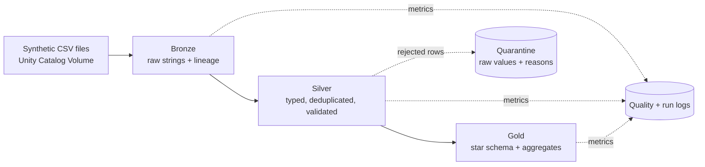

# Banking Transactions Lakehouse

An end-to-end data-engineering project on **Databricks, PySpark and Delta Lake**. It ingests messy
retail-banking transactions through a **medallion architecture** (bronze → silver → gold), with a
measurable data-quality framework, reconciliation checks, and a star-schema reporting mart.

> **Note:** all data is synthetic and generated by `src/generate_data.py`. The project mirrors
> enterprise practice (lineage, quarantine, reconciliation, governance). It is not production
> experience, and the [limitations](#limitations-and-assumptions) section says what would change at bank scale.

---

## Architecture



| Layer | Purpose | Status |
|---|---|---|
| **Bronze** | Raw data, unchanged, as strings. Adds `_ingested_at`, `_source_file`, `_batch_id` | Done |
| **Silver** | Typed, deduplicated, validated. Rejected rows go to a quarantine table with reasons | Done |
| **Quality layer** | Config-driven rules, results history table, pipeline gate, reconciliation | Code written; results pending |
| **Gold** | Star schema (`fact_transactions` + dimensions) and aggregate tables | Planned |

## Tech stack
Databricks (Unity Catalog, Volumes, Workflows) · PySpark · Delta Lake · Python · SQL · GitHub Actions · pytest

## Repository structure
```
├── README.md
├── src/
│   ├── generate_data.py        # synthetic data + deliberately injected dirty data
│   ├── silver_transforms.py    # pure PySpark functions (unit-testable)
│   ├── dq_framework.py         # rule engine: rules in, results DataFrame out
│   └── dq_rules.py             # the rules themselves, as data
├── notebooks/
│   ├── 01_bronze_ingest.py     # Databricks notebook (source format)
│   ├── 02_silver_transform.py
│   └── 03_data_quality.py
├── tests/                      # pytest suite (planned)
└── docs/screenshots/
```

## The data

| Table | Rows | Notes |
|---|---|---|
| customers | 20,000 | Province, segment, dates of birth, onboarding date |
| accounts | about 31,000 | 1 to 3 per customer; cheque, savings, credit card |
| merchants | 1,500 | Category and province |
| transactions | 510,000 | 500,000 unique + 10,000 duplicates, delivered as 3 files to mimic daily drops |

**Injected data-quality problems** (the generator writes the counts to `dirty_data_manifest.json`):

| Problem | Approx. rate |
|---|---|
| NULLs in `merchant_id`, `amount`, `channel` | about 2.7% each |
| Mixed date formats (`yyyy-MM-dd` vs `dd/MM/yyyy`) | 3% |
| Impossible or unparseable dates (`31/02/2026`, `not_a_date`) | 0.5% |
| Channel text variants (`" pos "`, lower-case) | 5% |
| Amounts stored as text (`R153,62`) | 2% |
| Orphan foreign keys (account does not exist) | 0.4% |
| Amount outliers (about 1000x) | 0.1% |
| Duplicate rows | 2% |

## Day 1: Bronze layer

**Design choices**
- **Everything is read as strings** (`inferSchema=false`), so bad values like `"R153,62"` survive intact instead of silently becoming NULL. Cleaning is silver's job.
- **Row-level lineage:** every row records its source file (`_metadata.file_path`), ingestion time and batch ID.
- **Reconciliation:** bronze row counts are checked against the generator's manifest, and the notebook halts if they differ.

**Baseline measured on bronze** (the "before" for every later improvement):

| Metric | Value |
|---|---|
| NULL `merchant_id` | 2.67% |
| NULL `amount` | 2.67% |
| NULL `channel` | 2.53% |
| Duplicate `transaction_id` rows | 10,000 (1.96%) |
| Channel values | 5 valid + 5 dirty spellings + 12,914 NULLs |

## Day 2: Silver layer

Rules are applied in a deliberate order: **standardise → deduplicate → validate → split**.
Deduplicating first stops one bad row that was duplicated from being counted as two rejections.

| Rule | Action |
|---|---|
| Exact duplicate `transaction_id` | Keep the first-ingested row; count the rest as "duplicates removed" |
| Amount like `R153,62` | Parse to `decimal(18,2)` = 153.62 |
| Mixed date formats | Parse both; dates are read **day-first** (`dd/MM/yyyy`) |
| Channel case and whitespace | Trim and upper-case |
| NULL `merchant_id` or `channel` | Impute `'UNKNOWN'` and set `merchant_imputed` / `channel_imputed` |
| Missing or unparseable amount | **Quarantine** (`MISSING_AMOUNT`, `INVALID_AMOUNT`): a monetary value is never guessed |
| Missing or impossible timestamp | **Quarantine** (`MISSING_TIMESTAMP`, `INVALID_TIMESTAMP`) |
| `account_id` not in `silver_accounts` | **Quarantine** (`ORPHAN_ACCOUNT_ID`) |
| Refund sign inconsistent with `is_refund` | **Quarantine** (`REFUND_SIGN_MISMATCH`) |
| `abs(amount)` > R50,000 | **Flag** `is_amount_outlier`; the row stays in silver |

**Reconciliation invariant**, asserted on every run:

```
bronze rows = silver rows + quarantined rows + duplicates removed
```

## Day 2 results (silver)

Measured on the full 510,000-row run:

| Metric | Bronze (before) | Silver (after) |
|---|---|---|
| NULL cells in key columns (`merchant_id`, `amount`, `channel`, `transaction_ts`) | 40,125 | 0 |
| Duplicate `transaction_id` rows | 10,000 | 0 |
| Rows | 510,000 | 482,283 |
| Rows quarantined | n/a | 17,717 (3.47%) |

**Reconciliation holds:** 510,000 = 482,283 silver + 17,717 quarantined + 10,000 duplicates removed.

**Quarantine reasons:**

| Reason | Count |
|---|---|
| `MISSING_AMOUNT` | 13,333 |
| `INVALID_TIMESTAMP` | 2,500 |
| `ORPHAN_ACCOUNT_ID` | 2,000 |

The reason counts add up to more than 17,717 because a row can fail more than one rule.

**Values repaired rather than rejected:** 15,726 day-first dates parsed, 9,709 text amounts (`R153,62`) converted,
25,000 channel values normalised.
**Imputed and flagged (`'UNKNOWN'`):** 12,921 `merchant_id` and 12,165 `channel` values. **Amount outliers flagged and kept:** 390.

**How to read the 100% null reduction fairly:** nulls in `amount` and `transaction_ts` disappear because those rows
are *rejected*. Nulls in `merchant_id` and `channel` disappear through *explicit imputation* (`'UNKNOWN'` plus a
flag column). Both are reported next to the headline so the improvement isn't overstated.

## Day 3: Data-quality framework

Quality is measured by **rules defined as data** (`src/dq_rules.py`) and evaluated by one engine
(`src/dq_framework.py`) that runs unchanged on every layer.

| Rule kind | Checks |
|---|---|
| `not_null` | Column has no NULLs |
| `unique` | Non-null values don't repeat |
| `accepted_values` | Values come from an allowed set |
| `range` | Values fall within min and max |
| `regex` | Values match a pattern |
| `foreign_key` | Values exist in a parent table (with documented sentinels such as `'UNKNOWN'`) |
| `sql_expression` | Any custom rule, e.g. refund sign must match `is_refund` |

**Design choices**
- **Bronze runs the same rules and is expected to fail.** That makes the "before" a measurement, not an anecdote.
- **Results are append-only** in `dq_results`, with `dq_latest` as a view of the newest run, so quality can be tracked over time.
- **Severity:** `error` rules block the pipeline through `assert_no_failures()`; `warn` rules only report. Outliers are flagged and kept on purpose, so that rule is a warning.
- **Only `not_null` cares about NULLs.** Every other rule ignores them, so one problem is reported once.
- **Reconciliation is itself a rule**, so a lost row shows up in the same table as every other failure.

**Results:** _fill from the Day 3 run (rules passing per layer, reliability %)._

## How to run

1. Create a Databricks workspace (the free tier works; check its current limits).
2. Clone this repo into a Databricks Git folder (or import `src/` and `notebooks/` keeping the same structure).
3. Run `notebooks/01_bronze_ingest.py` top to bottom. It creates the schema and volume, generates the data and loads bronze.
4. Run `notebooks/02_silver_transform.py`, then `notebooks/03_data_quality.py`.

To generate data locally instead: `python src/generate_data.py --rows 500000 --out ./data --seed 42`.

## Roadmap

- [x] **Day 1:** workspace, synthetic data generator, bronze ingestion, reconciliation, baseline profile
- [x] **Day 2:** silver cleaning, quarantine table, run summary
- [ ] **Day 3:** data-quality framework (`dq_results` table, pipeline gate) *(code written; record results after the run)*
- [ ] **Day 4:** gold star schema (`fact_transactions`, `dim_customer`, `dim_account`, `dim_merchant`, `dim_date`) + aggregates
- [ ] **Day 5:** Databricks Workflow, incremental loads with Delta `MERGE`, lineage view
- [ ] **Day 6:** pytest suite, GitHub Actions CI, PySpark vs pandas timing comparison

## Limitations and assumptions

- **Synthetic data.** Real bank data brings PII handling, masking, retention rules and access control, none of which are modelled here.
- **Dates are assumed day-first.** An ambiguous `03/04/2026` is read as 3 April.
- **The outlier threshold (R50,000) is a fixed business rule.** A production system would tune it per segment or product.
- **Imputing `'UNKNOWN'` trades completeness for usability.** It is always flagged so downstream users can exclude those rows.
- **Day 1 and 2 use full overwrite loads.** Incremental processing with `MERGE` arrives on Day 5.
- **Single-node, small-scale.** There is no cluster tuning or partitioning strategy yet.